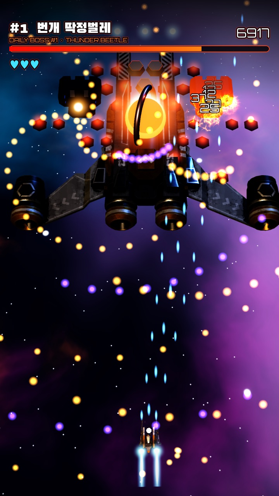
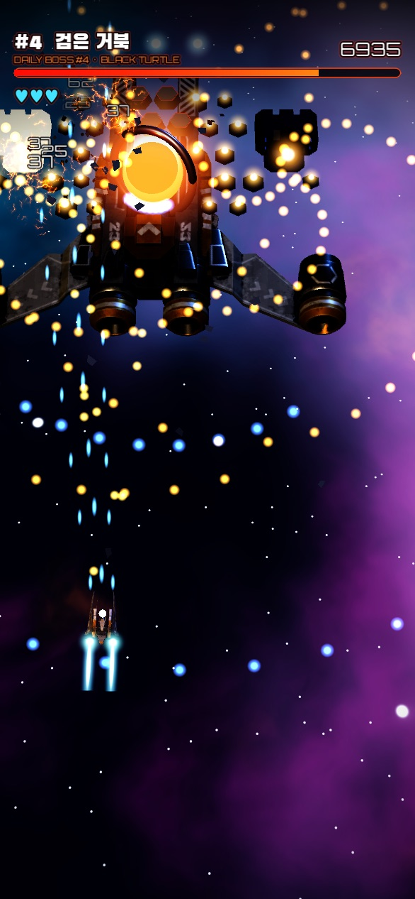
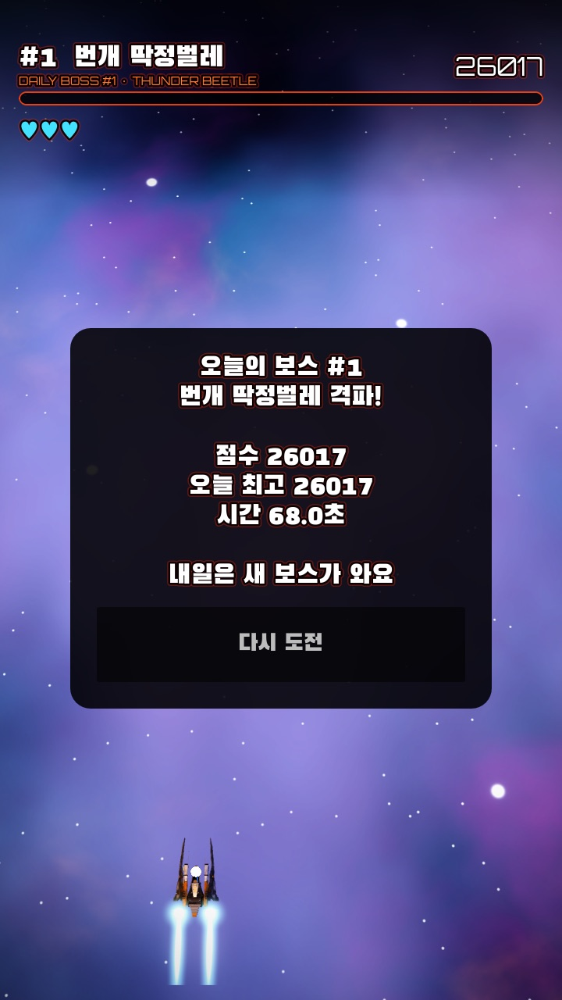

# thirdPrj — 보스 러시 (가칭)

## 🎮 최신 게임 화면(2026-11-18, 3D + 오늘의 보스)

| 오늘의 보스 #1 | #4(다른 날) | 결과 |
|---|---|---|
|  |  |  |

※ #4 화면은 공정성 조정 전(파란 적탄) — 지금은 적탄에 파랑·청록을 쓰지 않습니다.

> **🎨 최신 그림 시안 보기 → [docs/ART_REVIEW.md](docs/ART_REVIEW.md)** (2026-11-17 저녁)

매주 새 거대 보스가 오는 세로 탄막 슈팅(Godot 4.7, iOS·안드로이드). 개인 1인 개발.

- 지금 상태·바로 할 일: [docs/HANDOFF.md](docs/HANDOFF.md)
- 기획: [docs/GDD.md](docs/GDD.md) · 결정 기록: [docs/DECISIONS.md](docs/DECISIONS.md) · 할 일: [docs/TODO.md](docs/TODO.md)
- 작업 규칙(사람·AI 에이전트 공통): [AGENTS.md](AGENTS.md) · 환경: [docs/SETUP.md](docs/SETUP.md) · 에셋 라이선스: [docs/ASSETS.md](docs/ASSETS.md)
