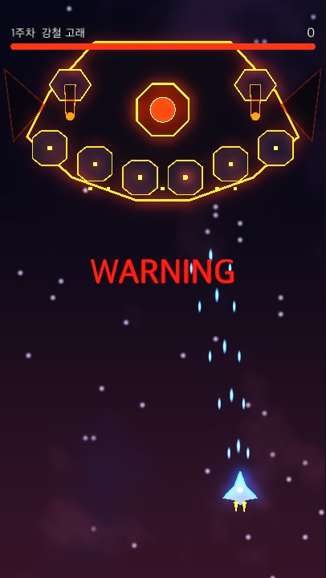
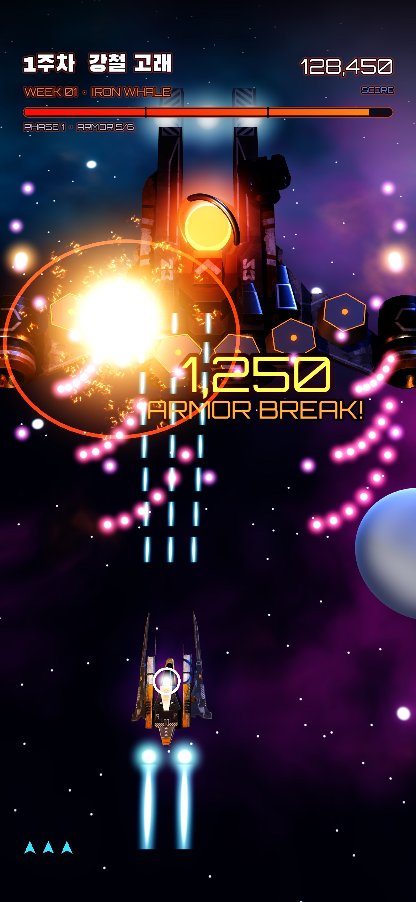

# 그림 시안 비교 — 보스 러시 (2026-11-17 저녁)

> 사용자 판정 "지금 게임 화면이 허접"(코드로 그은 선·다각형) → 같은 장면(**첫 장갑이 터지는 순간**)을 다시 그려 비교합니다. 기준은 "신경 쓴 게 느껴지는 첫인상".

## 나란히 보기

| 이전: 코드 그림 | 새 시안 ①: 3D CC0 모델 + 조명·재질·연출 |
|---|---|
|  |  |

(새 시안은 아이폰 세로 해상도 1170×2532로 렌더한 실제 Godot 화면입니다. 원본: [`screens/art/3d-final.jpg`](screens/art/3d-final.jpg))

## 시안 ① 3D CC0 모델 — 무엇을 바꿨나
- **보스**: Quaternius 「Executioner」 함선(CC0)을 몸통으로, 금속 재질로 덮고 크게. 앞쪽 호에 **코드로 만든 육각 금속 장갑판 6장**(주황 이음새가 빛남), 날개에 Kenney 포탑(같은 금속 재질로 덮어 화풍 통일), 가운데 **빛나는 핵 + 도는 고리**, 뒤쪽 엔진 불빛.
- **내 기체**: Quaternius 「Striker」(CC0), 테두리 빛 + 긴 청색 엔진 불꽃.
- **조명**: 따뜻한 주광 + 차가운 역광, 그림자, ACES 톤 매핑, 빛 번짐(글로우), 대비·채도 살짝.
- **배경 깊이**: 코드로 그린 성운(청록·자주·주황 먼지띠)과 별 → 흘러가는 구름 두 겹 → 먼 가스 행성. 가장자리 비네트.
- **탄막**: 주황 부채꼴·자홍 고리 탄(가운데 하얀 심이 있는 빛 구슬), 내 탄은 가는 청색 레이저 세 줄기.
- **파괴 순간**: 섬광 광원, 불덩이·불꽃 입자, 충격파 고리, 금속 파편 16조각, 피해 숫자 「1,250 ARMOR BREAK!」.
- **UI 마감**: 무료 글꼴(한글 Black Han Sans, 숫자·영문 Orbitron, 둘 다 OFL), 보스 이름판, 테두리·그러데이션·단계 눈금이 있는 체력 바, 점수, 기체 모양 목숨 아이콘, 위쪽 그늘.

### 장점
- 이전보다 "게임 같음"이 확 올라감. 금속·빛·깊이가 있어서 스토어 스크린샷으로도 쓸 만한 방향.
- 전부 **CC0·OFL·직접 만든 코드**라 공개 저장소·상업 출시에 걸림이 없음.
- 보스를 "부품 조립"으로 만들어 지금 게임 구조(부위가 떨어져 나감)와 그대로 맞고, **AI가 데이터로 새 보스를 조립**하기도 쉬움(함선 몸통 × 장갑판 배치 × 포탑 × 색).

### 약점·남은 것
- Quaternius 함선은 다른 게임에서도 쓰이는 공개 모델이라, 보스마다 같은 몸통이 반복되면 티가 남 → 몸통 여러 종(팩에 11종) + 부품 조합 + 색으로 변주해야 함.
- 위에서 보면 보스 몸통이 "큰 전투기"처럼 읽힘. 진짜 거대함은 더 큰 축척·화면 밖으로 넘치는 구도·느린 움직임으로 보강 필요.
- 아직 **정지 시안**: 실제 게임(움직임·60fps·iPhone 성능)으로 옮기는 작업이 남음(탄은 MultiMesh로, 투명 레이어 수 줄이기 등 — 검수 의견 아래).

### 검수 의견(게임으로 옮길 때 고칠 것, 시안 화면에는 이미 반영한 것 포함)
- ✅ 반영: 피해 숫자가 폭발 위에 겹쳐 안 읽힘 → 옆 어두운 곳·굵은 테두리, 적탄이 폭발과 같은 주황 → 분홍빛으로, 기체 판정 점이 안 보임 → 흰 점 + 고리.
- 게임에서 고칠 것: 성운 셰이더가 픽셀마다 노이즈 18번(→ 미리 그린 텍스처), 반투명 구름 3장 + 성운이 화면 전체를 4번 겹침(→ 1~2장), 탄이 하나씩 그리기 호출(→ MultiMesh에 색 넣기), 함선 텍스처 2048² 무압축 약 21MB씩(→ VRAM 압축·1024 제한), 글로우 상위 단계 비용·그림자는 빼도 티 안 남.

## 시안 ② AI 일러스트 — 진행 안 함(사용자 확인 필요)
- 이 PC에 연결된 이미지 생성 도구(Figma AI)는 **호출마다 유료 크레딧이 차감**되고, 연결된 Figma가 **회사 계정일 가능성**이 커서 개인 프로젝트에 쓰지 않았습니다.
- 진행하려면: 개인 계정의 이미지 생성 도구(무엇을 쓸지)와 **상업 이용 약관**을 정해 주시면, 같은 장면을 그려 이 문서에 추가합니다. 약관 확인 전 생성물은 공개 저장소에 올리지 않습니다.
- 디자인 담당 권고는 원래 "움직이는 건 3D, AI 그림은 장 표지·초상화·스토어 이미지 같은 **정지 이미지에만**"이었습니다.

## 고르실 것
1. **이 3D 방향으로 실제 게임을 다시 만들까요?** (추천) — 다음 단계: 게임 화면을 3D로 옮기고(조작·판정은 그대로), iPhone에서 첫 10초 판정.
2. 3D는 좋은데 더 손볼 곳(색감·보스 크기·UI 등)을 말씀해 주시면 반영해서 다시 렌더.
3. AI 일러스트도 보고 싶으면 쓸 도구·계정을 알려 주세요.
